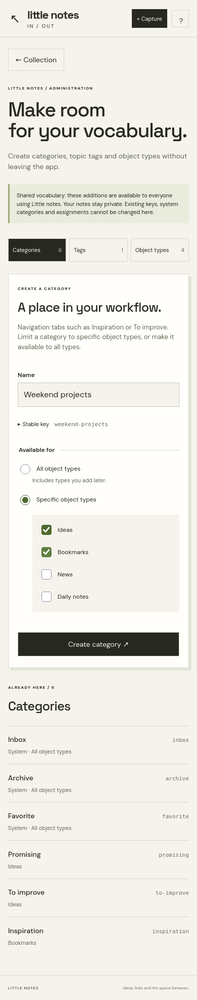
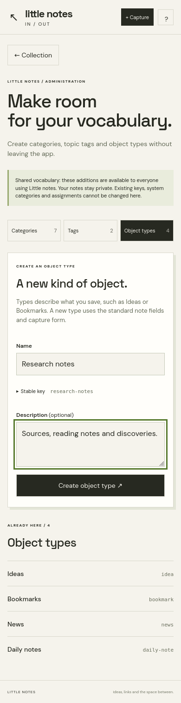
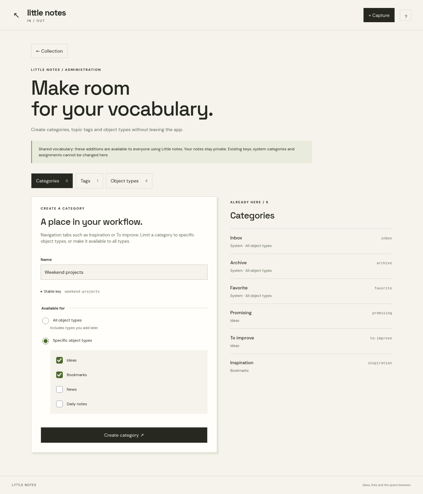

# Little notes vocabulary administration

Open **Manage** in Little notes (staff accounts only). Choose Categories, Tags or Object types, enter a name and create it. A stable key is generated automatically; expand Stable key to set it yourself before creation.

- Categories are navigation tabs. Select All object types (also includes future types), or one or more specific active types.
- Tags describe topics and do not move content between categories.
- Object types use the existing standard content fields and capture form. There is no custom-field builder.
- Vocabulary is shared across users, as in the existing schema. Notes remain owner-scoped. Both the capability flag and create endpoint use Django's existing `is_staff` permission.
- Create-only: no changes to existing keys, category scopes, system categories or assignments. No deletes, schema changes or production data writes are part of this PR.
- Keys are lowercase ASCII letters, numbers and single hyphens. Duplicate keys and reserved navigation keys are refused. Defaults append new entries to the existing ordering.

## Checks

Focused API/model tests:

```sh
cd api
python manage.py test apps.curator --settings=apps.curator.test_settings
python manage.py makemigrations --check --dry-run --settings=apps.curator.test_settings
```

Visual and interaction checks use synthetic data, not production accounts:

```sh
cd ui
npx playwright install firefox
node taxonomy-admin-visual-check.mjs
```

The script checks Firefox and Chromium at 320, 390 and 1280 pixels; no horizontal overflow; universal/multiple-type category creation; tag and type creation; accent-to-key generation; retained input on a duplicate conflict; updated capture choices; and non-staff UI gating. It writes screenshots under `/tmp/little-notes-admin-screenshots` by default. Firefox is desktop Firefox at mobile-sized viewports, not a physical Android Firefox device.

Screenshots were visually inspected after the final UI changes. All content is synthetic.




